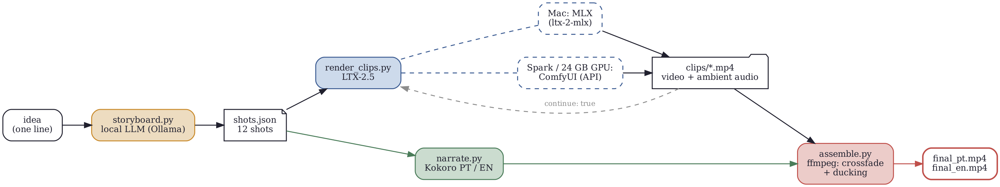
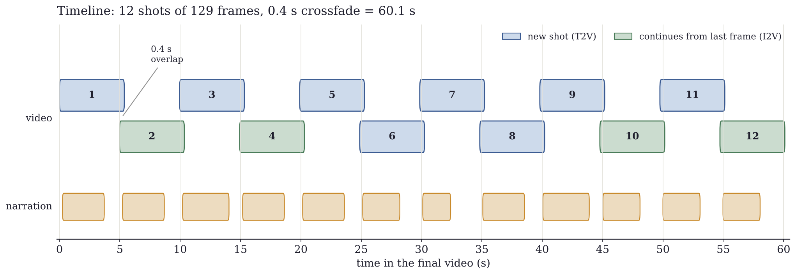

# local-animation-pipeline

A one-minute AI film, rendered 100% locally, with the same code on three very different machines:

| | Mac M5 Max 128 GB | DGX Spark (GB10) | PC with a 24 GB GPU |
|---|---|---|---|
| Video model | LTX-2.5 via MLX ([ltx-2-mlx](https://github.com/dgrauet/ltx-2-mlx)) | LTX-2.5 in ComfyUI, bf16 | LTX-2.5 in ComfyUI, int8 |
| Backend flag | `--backend mlx` | `--backend comfy` | `--backend comfy` |

The pipeline turns a storyboard of 12 shots into a 60.1-second film with LTX-2.5's native ambient audio, crossfades, and narration in English and Brazilian Portuguese from [Kokoro](https://huggingface.co/hexgrad/Kokoro-82M). The same clips produce both language cuts.

Tutorial: [EN](<ARTICLE_URL_EN>) · [PT-BR](<ARTICLE_URL_PT>) · Leia em português: [README.pt-BR.md](README.pt-BR.md)



## Why 12 × 129 frames

LTX needs frame counts of the form 8k + 1 and width/height divisible by 32. At 24 fps, 129 frames is 5.375 s. Twelve shots joined by 0.4 s crossfades give 12 × 5.375 − 11 × 0.4 = **60.1 s**. Working resolution is 1024×576; `youtube_export.py` upscales to 1080p.



## Files

| File | What it does |
|---|---|
| `examples/water_cycle.json` | Sample storyboard: the water cycle followed by one drop, 12 shots |
| `storyboard.py` | Writes a storyboard from a one-line idea with a local LLM (Ollama), and validates hand-written ones |
| `render_clips.py` | Renders every shot (`mlx` or `comfy` backend), chains `continue: true` shots from the previous last frame, logs `clips/timings.csv` |
| `narrate.py` | Kokoro narration (PT or EN), each line placed at its shot's start |
| `assemble.py` | ffmpeg edit: `xfade` + `acrossfade`, narration ducking over the ambient audio |
| `youtube_export.py` | 1920×1080, −14 LUFS loudness, 1280×720 thumbnail |
| `bench_summary.py` | Compares `timings.csv` files from several machines |
| `prompts/` | A ready-to-paste prompt for a coding agent to run the whole thing on your machine |
| `tools/make_figures.py` | Regenerates the figures in `docs/figures/` |

## Requirements

All machines: Python 3.11+, `ffmpeg`, `espeak-ng` (`brew install espeak-ng` / `sudo apt install espeak-ng`).

```bash
python -m venv .venv && source .venv/bin/activate
pip install -r requirements.txt -r requirements-narration.txt
python -m pytest -q          # 13 tests, including a full 60 s edit on synthetic clips
```

The LTX-2.5 weights live on [Hugging Face](https://huggingface.co/Lightricks/LTX-2.5) behind a license gate. Accept it and run `hf auth login` before downloading. LTX-2.x Community License: free commercial use under US$10M annual revenue.

## Mac (Apple Silicon)

```bash
git clone https://github.com/dgrauet/ltx-2-mlx.git ../ltx-2-mlx
cd ../ltx-2-mlx && uv sync --all-extras && source .venv/bin/activate
ltx-2-mlx info --model dgrauet/ltx-2.5-mlx-q8
cd ../local-animation-pipeline
pip install -r requirements.txt -r requirements-narration.txt
python render_clips.py --backend mlx --shots examples/water_cycle.json --machine "M5 Max 128GB"
```

If a shot dies with a Metal command-buffer error, set `LTX2_DIT_EVAL_EVERY=4` and retry it with `--only N`.

## DGX Spark

```bash
python3 -m venv ../comfyui-env && source ../comfyui-env/bin/activate
pip3 install torch torchvision --index-url https://download.pytorch.org/whl/cu130
git clone https://github.com/comfyanonymous/ComfyUI.git ../ComfyUI
cd ../ComfyUI && pip install -r requirements.txt
cd models && hf download Lightricks/LTX-2.5 \
  diffusion_models/ltx-2.5-22b-distilled-transformer-bf16.safetensors \
  text_encoders/gemma4-12b-with-proj-ltx-2.5-bf16.safetensors \
  vae/ltx-2.5-video-vae-bf16.safetensors \
  vae/ltx-2.5-audio-vae-bf16.safetensors \
  latent_upscale_models/ltx-2.5-latent-spatial-upscaler-x2-bf16-1.0.safetensors \
  --local-dir .
cd .. && python main.py --listen 0.0.0.0
```

Use a current ComfyUI (NVIDIA's playbook pins an older one). Don't enable block swap: on unified memory it only slows things down. `ltx-2.5-22b-distilled-transformer-nvfp4.safetensors` is worth a try on Blackwell.

## PC with a 24 GB GPU

Same ComfyUI install (regular CUDA torch for your platform), but download the ComfyUI-only int8 files instead of the bf16 transformer and encoder:

```
diffusion_models/ltx-2.5-22b-distilled-transformer-comfy-int8-convrot.safetensors
text_encoders/gemma4-12b-with-proj-ltx-2.5-comfy-int8-convrot.safetensors
```

plus the same VAEs and upscaler. One render at a time, nothing else on the GPU, 64 GB of system RAM recommended.

## Exporting the ComfyUI workflows

`render_clips.py` drives ComfyUI through its HTTP API and needs two API-format workflows in `workflows/`:

1. Open the **LTX-2.5 T2V** template, set 1024×576, render one clip from the UI to confirm it works.
2. Rename the positive prompt node's title to `PROMPT`.
3. **Workflow → Export (API)** → `workflows/t2v_api.json`.
4. Same with **LTX-2.5 I2V**: title the prompt `PROMPT` and the image loader `IMAGE`, export `workflows/i2v_api.json`.

The script replaces the `PROMPT` text, the `IMAGE` file, and every integer input named `length`, `num_frames`, `frames_number`, `seed` or `noise_seed`. Check what it will touch before spending GPU time:

```bash
python render_clips.py --backend comfy --shots examples/water_cycle.json --dry-run
python render_clips.py --backend comfy --shots examples/water_cycle.json --machine "DGX Spark"
# render on another box over the network
python render_clips.py --backend comfy --comfy-url http://192.168.1.50:8188 --machine "RTX 4090"
```

## Narrate, assemble, export

```bash
python narrate.py --shots examples/water_cycle.json --lang en
python narrate.py --shots examples/water_cycle.json --lang pt
python assemble.py --lang en -o out/water_cycle_en.mp4
python assemble.py --lang pt -o out/water_cycle_pt.mp4
python youtube_export.py out/water_cycle_en.mp4 -o youtube/water_cycle_en_1080p.mp4
```

Redo single shots with `--only 4 7`. Compare machines with:

```bash
python bench_summary.py mac/timings.csv spark/timings.csv pc/timings.csv
```

## Your own film

```bash
ollama pull qwen2.5:14b
python storyboard.py "a paper boat crossing a city during a storm" -o shots.json
python storyboard.py --check shots.json
```

Read it before rendering. Avoid human faces and on-screen text: identity drift between shots and melting letters are the most visible failure modes. Don't chain more than two `continue: true` shots in a row, since each hop starts from an already-compressed frame.

## License

MIT for the code in this repository. The models keep their own licenses: LTX-2.x Community License (LTX-2.5), Apache 2.0 (Kokoro), MIT ([ltx-2-mlx](https://github.com/dgrauet/ltx-2-mlx)).
