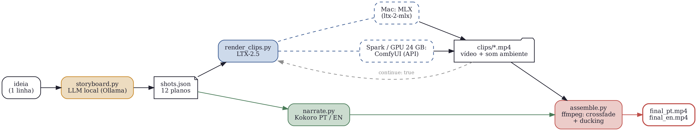

# local-animation-pipeline

Um filme de IA de um minuto, renderizado 100% local, com o mesmo código em três máquinas bem diferentes:

| | Mac M5 Max 128 GB | DGX Spark (GB10) | PC com GPU de 24 GB |
|---|---|---|---|
| Modelo de vídeo | LTX-2.5 via MLX ([ltx-2-mlx](https://github.com/dgrauet/ltx-2-mlx)) | LTX-2.5 no ComfyUI, bf16 | LTX-2.5 no ComfyUI, int8 |
| Flag de backend | `--backend mlx` | `--backend comfy` | `--backend comfy` |

A pipeline transforma um roteiro de 12 planos num filme de 60,1 segundos, com o som ambiente nativo do LTX-2.5, crossfades e narração em português e inglês com o [Kokoro](https://huggingface.co/hexgrad/Kokoro-82M). Os mesmos clipes geram as duas versões.

Tutorial: [PT-BR](<URL_ARTIGO_PT>) · [EN](<URL_ARTIGO_EN>) · Instruções completas de instalação por máquina: [README.md](README.md)



## Rodando rápido

```bash
python -m venv .venv && source .venv/bin/activate
pip install -r requirements.txt -r requirements-narration.txt
python -m pytest -q

# Mac
python render_clips.py --backend mlx --machine "M5 Max 128GB"
# Spark ou PC de 24 GB (ComfyUI em :8188, workflows exportados em workflows/)
python render_clips.py --backend comfy --dry-run
python render_clips.py --backend comfy --machine "DGX Spark"

python narrate.py --lang pt
python narrate.py --lang en
python assemble.py --lang pt -o out/agua_pt.mp4
python assemble.py --lang en -o out/water_en.mp4
python youtube_export.py out/agua_pt.mp4 -o youtube/agua_pt_1080p.mp4
```

Por padrão, os scripts usam `examples/water_cycle.json`. Para o seu próprio filme, gere um roteiro com `python storyboard.py "sua ideia" -o shots.json` e passe `--shots shots.json`.

## Rodar tudo com um agente

Em `prompts/rodar-localmente.pt-BR.md` há um prompt pronto para colar num agente de código (Claude Code, por exemplo) na máquina que vai renderizar. Ele detecta o hardware, pede confirmação antes de baixar os pesos, renderiza o plano 1 e espera você aprovar, faz o resto, narra, monta, exporta para o YouTube e escreve títulos, descrição e tags com o link do tutorial.

## Licença

Código sob MIT. Os modelos mantêm as próprias licenças: LTX-2.x Community License (LTX-2.5, grátis para uso comercial abaixo de US$ 10 milhões de faturamento anual), Apache 2.0 (Kokoro), MIT (ltx-2-mlx).
